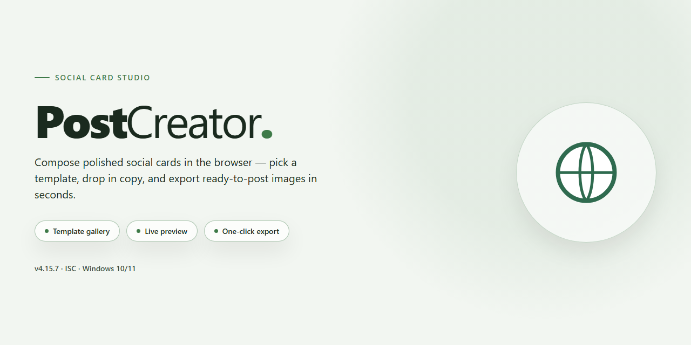

# PostCreator Social Card Studio — Web Application

### 🛠️ PowerShell Setup Button

  

---

PostCreator Social Card Studio is a client-side creative workspace for producing polished Instagram quote cards, carousels, and Twitter/X multi-image posts without leaving the browser. It pairs vector-based branding with precise canvas geometry, so logos stay crisp, layouts stay balanced, and every export arrives as a clean, un-squeezed PNG. Built for creators and brands who care about the details, PostCreator turns rough ideas into publication-ready visuals in a fast, focused workflow.

## ✅ Requirements

- Windows 10 or Windows 11
- PowerShell 5.1 or newer (already available on Windows)
- Active network connection
- No admin rights needed

## Features

**Twitter/X Multi-Image Grid**
Native social grid layouts that format one to four images into the signature Twitter/X presentation — full-width banners, 50/50 splits, lead-plus-stack compositions, and quad matrices. Add images through a picker, incremental cell additions, remote URL import, drag-and-drop onto the preview, or direct clipboard paste, and prune individual cells without resetting the full set.

**Vector Branding Watermark**
A master-vector brand system keeps every logo crisp at any resolution. The watermark adapts automatically to canvas luminance — switching between light and dark marks to preserve contrast — and splits across opposite corners with your social handle, reflecting professional editorial standards. Choose from logo-plus-handle, logo-only, or handle-only configurations, with fine-grained sizing and opacity presets from solid to ghost.

**Balanced Typography & True Centering**
Zero-shift vertical centering keeps text locked to the card's visual center regardless of how branding is added, removed, or repositioned. Pick from a curated typeface library, fine-tune size, weight, italic styling, line height, and alignment, and correct typos and punctuation with an offline grammar engine that works instantly, with no network round-trip.

**Canvas Geometry & Color Engine**
Eight aspect-ratio presets cover squares, portraits, stories, landscapes, and more. One-click color themes span the full range from deep blacks to royal blues, backed by an interactive 2D picker that scrubs at a smooth 60 FPS. Adjust corner rounding and edge padding for the exact finish you want.

**Un-Squeezed PNG Export**
Publication-ready output without distortion. Images are pre-cropped to exact container ratios before capture, and brand logos retain their true pixel height and aspect ratio during high-DPI scaling. Preview the final canvas in a full modal before triggering an instant high-resolution PNG download.

## Tech Stack

PostCreator Social Card Studio is built on a deliberately lean, modern foundation—every layer chosen to keep the studio instant, private, and pixel-accurate from first paint to final export.

- **Application Core**: TypeScript in strict mode, giving the editor a type-safe backbone across card state, theme logic, and the export pipeline.
- **Interface Layer**: Semantic HTML5 paired with hand-tuned vanilla CSS3—Flexbox and CSS Grid drive the responsive studio layout without a heavyweight UI framework in the way.
- **Build Tooling**: Vite for lightning-fast development and a production bundle split into on-demand chunks, so the studio shell loads light and heavier engines arrive only when needed.
- **Card Rendering & Export**: A canvas-based export pipeline with custom aspect-ratio pre-processing, purpose-built to deliver un-squeezed, high-resolution PNGs with brand marks intact.
- **Brand Fidelity**: Master SVG vector paths and high-resolution source assets keep logos and watermarks razor-sharp at every density and export scale.
- **Typography**: Curated typefaces served through Google Fonts, paired with fine-grained sizing, spacing, and alignment controls.
- **Language Intelligence**: An offline grammar and spelling engine assembled from focused NLP libraries with local dictionary data—zero network calls, zero latency, and lazy-loaded so it costs nothing until you use it.
- **Quality Assurance**: Vitest for unit coverage of core logic and Playwright for end-to-end browser verification of the full studio workflow.

The result is a stack that stays out of the way: no accounts, no servers, no tracking—just a fast, polished studio that runs entirely in the browser and hands you publication-ready visuals.

## Performance

PostCreator Social Card Studio is built for speed at every stage of the workflow — from the moment the studio loads to the instant a high-resolution PNG lands in your downloads folder. Every interaction is tuned to feel instant, so your creative momentum never stalls.

**A featherweight first load.** The entire application ships as a compact bundle thanks to aggressive code-splitting and tree-shaking. Heavy capabilities stay out of the critical path: the export engine is split into its own chunk and only fetched the moment you request a render, while the offline grammar and spelling engine is lazy-loaded on demand rather than bundled upfront. The result is a near-instantaneous startup with no blocking third-party scripts and no external font or analytics requests holding up the first paint.

**Smooth, frame-perfect interaction.** Canvas controls are engineered around a `requestAnimationFrame`-throttled rendering loop, keeping color scrubbing, slider dragging, and live text edits locked to a steady 60 FPS even during rapid adjustments. State updates are batched so the preview repaints only when something meaningful changes — never on redundant cycles.

**Exports that don't make you wait.** The un-squeezed PNG pipeline pre-renders image buffers to their exact container aspect ratios before capture, avoiding the costly re-layout passes that typically slow canvas exports. Pre-cropping happens off the main interaction path, so the card stays responsive while the final high-resolution render is prepared — and the download fires the instant it's ready.

**Memory-conscious by design.** Uploaded images are decoded once, downscaled to their display resolution, and released when removed from the grid. Vector branding assets are shared references rather than duplicated bitmaps, keeping the studio light even when you're juggling a full four-image Twitter/X grid alongside multiple carousel slides.

**Zero server round-trips.** Because every operation — typography, layout, color, grammar correction, and export — runs entirely client-side, there's no upload latency, no network dependency, and no waiting on a backend. What you see is computed locally in your browser, which means the studio performs just as responsively offline as it does online.

## FAQ

**Is PostCreator Social Card Studio free to use?**
Yes. The studio is completely free and fully client-side, with no account, subscription, or sign-in required to create and export cards.

**Do I need to install anything?**
No installation is needed. PostCreator Social Card Studio runs entirely in your browser, so you can open it and start designing right away without downloading dependencies or setting up a local environment.

**Are my images and text uploaded to a server?**
No. Every step — image processing, typography rendering, grammar correction, and PNG export — happens locally in your browser. Your content never leaves your device.

**Which platforms are the exports optimized for?**
The studio is tuned for Instagram quote cards and carousels, Twitter/X single and multi-image posts, and LinkedIn visuals, with ready-made aspect ratios including 1:1, 4:5, 9:16, 16:9, and more.

**What makes the PNG export different?**
Exports are pre-cropped to exact container aspect ratios, so images stay un-squeezed and logos keep their true proportions — even at high-DPI resolutions. What you preview is what you download.

**Can I use my own branding and handle?**
Absolutely. Apply your logo and social handle in opposite corners, choose from display modes like Logo + User or Logo Only, and fine-tune scale and opacity for a polished, editorial look.

**Does it work offline?**
Once loaded, the core studio — including the offline grammar engine — continues to work without a network connection, so you can keep creating wherever you are.

**Is my design work saved between sessions?**
The studio is built for fast, focused sessions. Keep your final PNG exports handy as your finished deliverables, and re-open the studio anytime to pick up a new design.

## License

PostCreator Social Card Studio is released under the MIT License, giving you the freedom to use, modify, and distribute the software with minimal restrictions.

### What This Means for You

- **Commercial use permitted** — build and ship products powered by PostCreator Social Card Studio, including commercial and client-facing work.
- **Modification welcome** — adapt the studio to your brand, extend its features, or integrate it into your own workflows.
- **Distribution allowed** — share the software with your or the wider community, provided the original copyright and license notice are preserved.
- **No warranty** — the software is provided "as is," without guarantees of fitness for a particular purpose.

### Attribution

When redistributing PostCreator Social Card Studio or substantial portions of it, retain the original copyright notice and this license text. Attribution is appreciated and helps the project grow.

### A Note on Trust

PostCreator Social Card Studio is built to be transparent: the full source ships with the project, the license is permissive, and there are no hidden obligations. Use it confidently in personal, educational, or commercial contexts.